# Product API on AWS ECS with Terraform

A small Product service written in Go with the [Gin](https://github.com/gin-gonic/gin) web framework.

Terraform builds the Docker image, pushes it to Amazon ECR, and runs it on Amazon ECS (Fargate), so the whole system is created and destroyed from the command line. The deployment is based on the course starter repository, adapted to run the Product API instead of the albums server.

The homework report (API specification, local and Docker test results, and deployment notes with screenshots) is in the course repository: [NU-CS6650/hw5/report.md](https://github.com/kulkarni-sharvari/NU-CS6650/blob/main/hw5/report.md).

## Repository layout

| Path | What it contains |
|--|--|
| `src/product-service.go` | The server code: in-memory store, GET and POST handlers, input validation, error responses |
| `src/Dockerfile` | Multi-stage build of the server image (built for `linux/amd64`) |
| `src/go.mod`, `src/go.sum` | Go module and dependencies |
| `terraform/` | The infrastructure as code (provider, variables, outputs, and the modules below) |
| `terraform/modules/network` | Default VPC subnets and a security group that opens the container port |
| `terraform/modules/ecr` | The ECR repository that stores the image |
| `terraform/modules/logging` | The CloudWatch log group (`/ecs/CS6650L2`) |
| `terraform/modules/ecs` | The ECS cluster, Fargate task definition and service |
| `images/` | Screenshots of the deployed API (referenced below) |

## Prerequisites

* AWS CLI v2
* Terraform
* Docker, **running** during `terraform apply`, because Terraform builds the image and pushes it to ECR
* Git

Go is not required because the server is compiled inside Docker. The default region is `us-east-1`.

## Deploy

### 1. Get the code

```bash
git clone https://github.com/kulkarni-sharvari/CS6650_hw5_demo.git
cd CS6650_hw5_demo
```

### 2. Prepare credentials

Retrieve your temporary credentials from the Learner Lab, then enter the access key and secret key when prompted (use the region `us-east-1`):

```bash
aws configure
```

Then set the session token:

```bash
aws configure set aws_session_token <YOUR-TEMP-SESSION-TOKEN>
```

The access key, secret key and session token all change every time the lab restarts, so update all three.

### 3. Apply the infrastructure

```bash
cd terraform
terraform init
terraform apply -auto-approve
```

The first apply takes a few minutes, because it builds the Docker image and pushes it to ECR before ECS starts the task.

## Find the public IP address

Run this from the `terraform` folder:

```bash
IP=$(aws ec2 describe-network-interfaces \
--network-interface-ids $(
    aws ecs describe-tasks \
    --cluster $(terraform output -raw ecs_cluster_name) \
    --tasks $(
        aws ecs list-tasks \
        --cluster $(terraform output -raw ecs_cluster_name) \
        --service-name $(terraform output -raw ecs_service_name) \
        --query 'taskArns[0]' --output text
    ) \
    --query "tasks[0].attachments[0].details[?name=='networkInterfaceId'].value" \
    --output text
) \
--query 'NetworkInterfaces[0].Association.PublicIp' \
--output text)

echo $IP
```

> **Timing:** the command prints nothing, or `None`, until the task is running. This is normal and usually lasts **1 to 2 minutes after `terraform apply` finishes**. It does not mean the deployment failed. Wait a minute and run it again. You can follow the task in the ECS console (Clusters, then `CS6650L2-cluster`, then the service, then Tasks) until its status is `RUNNING`.

## Send requests

The server listens on port `8080`. The service starts with three products (IDs `1` to `3`). The commands below use the `$IP` variable from the previous step.

| # | Endpoint | Case | Command | Status |
|--|--|--|--|--|
| 1 | GET | Product found | `curl -i http://$IP:8080/products/1` | `200` |
| 2 | GET | Product not found | `curl -i http://$IP:8080/products/999` | `404` |
| 3 | GET | Malformed ID (the spec has no `400` for GET) | `curl -i http://$IP:8080/products/abc` | `404` |
| 4 | GET | Forced server error | `curl -i -H "X-Force-Error: true" http://$IP:8080/products/1` | `500` |
| 5 | POST | Valid update | see below | `204` |
| 6 | POST | Product not found | see below | `404` |
| 7 | POST | Malformed ID | see below | `400` |
| 8 | POST | Invalid input (bad JSON, wrong type, missing or out-of-range fields) | see below | `400` |
| 9 | POST | Forced server error | see below | `500` |

`POST` replaces the details of an **existing** product. It never creates a product, so a missing ID returns `404`.

```bash
# 5. 204 - valid update (empty response body)
curl -i -X POST http://$IP:8080/products/1/details \
  -d '{"sku":"NEW-SKU-1","manufacturer":"Acme","category_id":2,"weight":750,"some_other_id":55}'

# 6. 404 - product does not exist
curl -i -X POST http://$IP:8080/products/999/details \
  -d '{"sku":"X","manufacturer":"Y","category_id":1,"weight":5,"some_other_id":1}'

# 7. 400 - malformed product ID
curl -i -X POST http://$IP:8080/products/abc/details \
  -d '{"sku":"X","manufacturer":"Y","category_id":1,"weight":5,"some_other_id":1}'

# 8. 400 - invalid input (examples)
curl -i -X POST http://$IP:8080/products/1/details -d 'not json'
curl -i -X POST http://$IP:8080/products/1/details -d '{}'
curl -i -X POST http://$IP:8080/products/1/details \
  -d '{"sku":"X","manufacturer":"Y","category_id":0,"weight":5,"some_other_id":1}'
curl -i -X POST http://$IP:8080/products/1/details \
  -d '{"sku":"X","manufacturer":"Y","category_id":1,"weight":-1,"some_other_id":1}'

# 9. 500 - forced server error
curl -i -X POST -H "X-Force-Error: true" http://$IP:8080/products/1/details \
  -d '{"sku":"X","manufacturer":"Y","category_id":1,"weight":5,"some_other_id":1}'
```

**Validation rules for the request body (all fields are required):** 
* sku: non empty and not more than 100 characters long
* manufacturer: non empty and not more than 200 characters long
* category_id: minimum 1
* weight: minimum 0
* some_other_id: minimum 1
* request body: must be well-formed JSON and each field must have the correct type (for example, "category_id": "abc" is rejected). The response uses the message Invalid request body with the details Bad request.

**About the `500` response:** the in-memory store cannot fail on its own, so a recovery middleware turns any panic into a `500` response. Sending the header `X-Force-Error: true` triggers one on purpose so that the response can be demonstrated. This header is a test-only hook.

**Schema**

**Product schema**

| Field | Type | Description |
|--|--|--|
| `product_id` | integer (`int64`) | Unique identifier of the product |
| `sku` | string (1 to 100 characters) | Stock Keeping Unit, a unique product code |
| `manufacturer` | string (1 to 200 characters) | Name of the manufacturer |
| `category_id` | integer (`int32`) | Identifier of the product category |
| `weight` | integer (`int32`) | Product weight in grams |
| `some_other_id` | integer (`int32`) | Additional product identifier |

**Error schema**

| Field | Type | Description |
|--|--|--|
| `error` | string | Machine-readable error code (for example, `NOT_FOUND`) |
| `message` | string | Human-readable error message |
| `details` | string | Additional context about the error |

### Screenshots from the deployed service

These requests were sent to the service running on ECS (using a Bruno collection, plus one `curl`).

| Case | Screenshot |
|--|--|
| GET `200` | 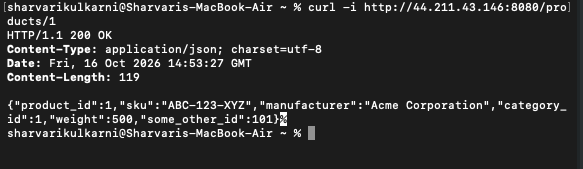 |
| GET `404`, product not found | 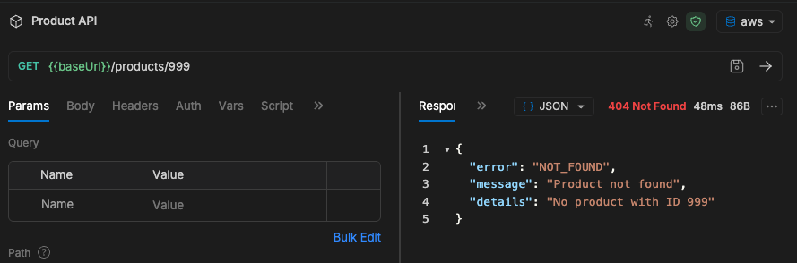 |
| GET `404`, malformed ID | 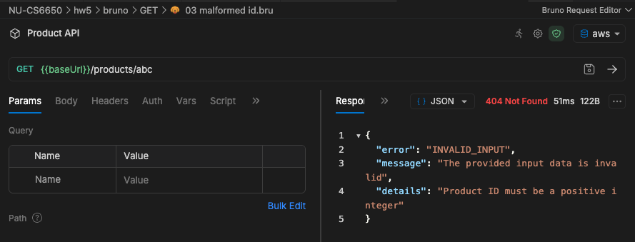 |
| GET `404`, ID `0` | 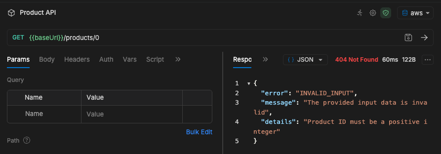 |
| GET `500` | 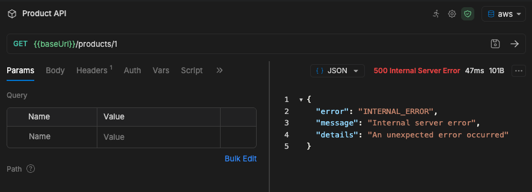 |
| POST `204` | 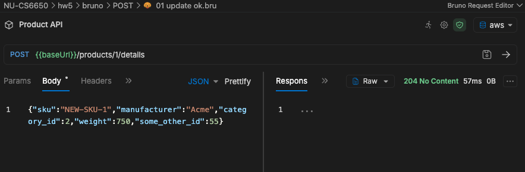 |
| GET after the update | 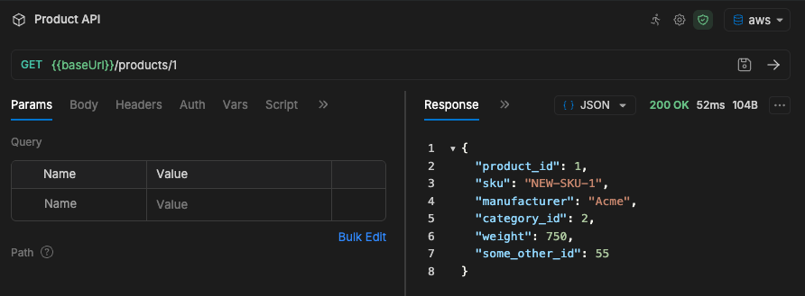 |
| POST `404` | 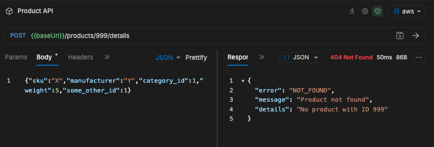 |
| POST `400`, malformed ID | 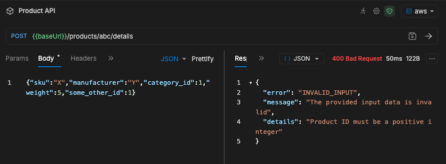 |
| POST `400`, invalid JSON | 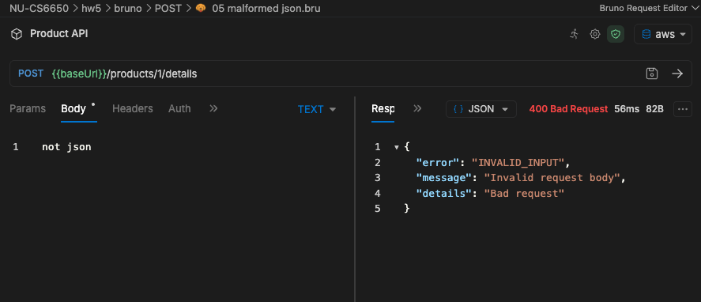 |
| POST `400`, wrong field type | 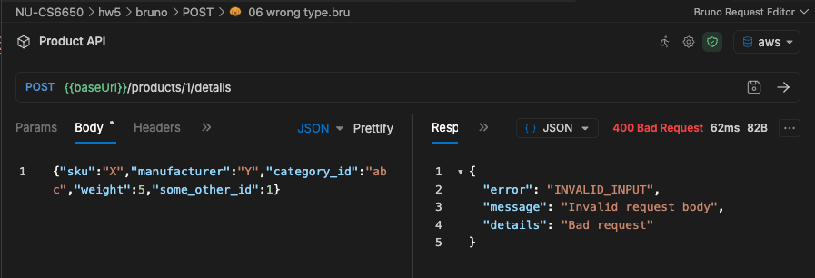 |
| POST `400`, empty object | 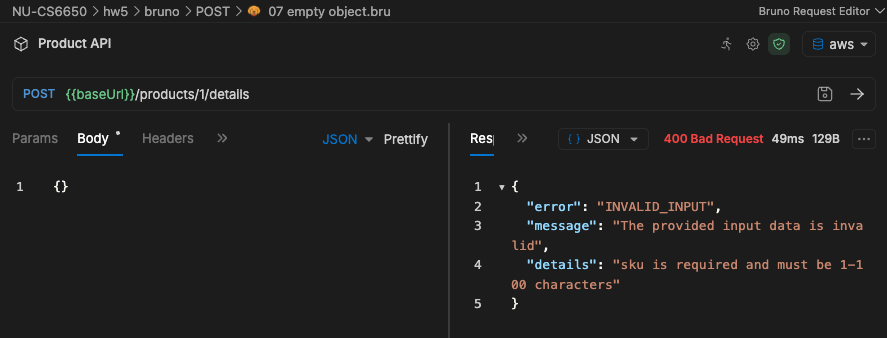 |
| POST `400`, empty `sku` | 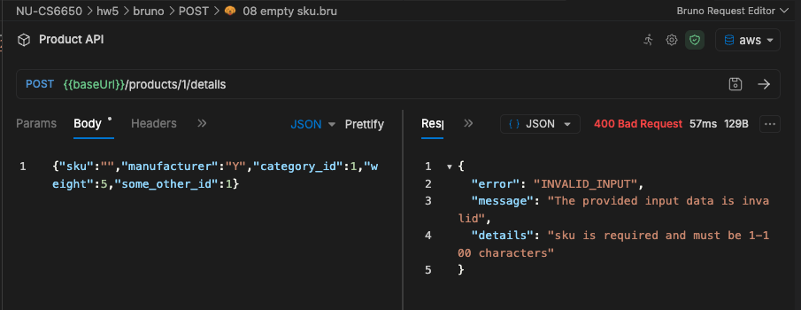 |
| POST `400`, `sku` over 100 characters | 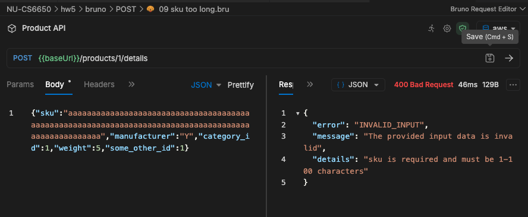 |
| POST `400`, negative `weight` | 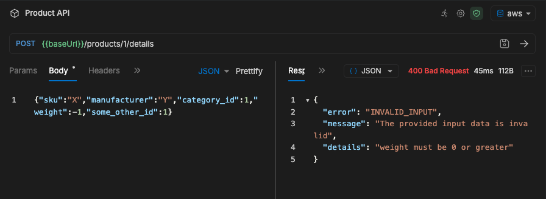 |
| POST `400`, `category_id` of 0 | 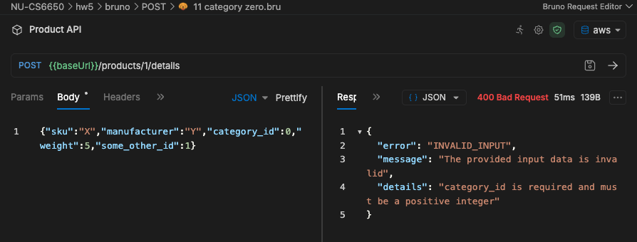 |
| POST `500` | 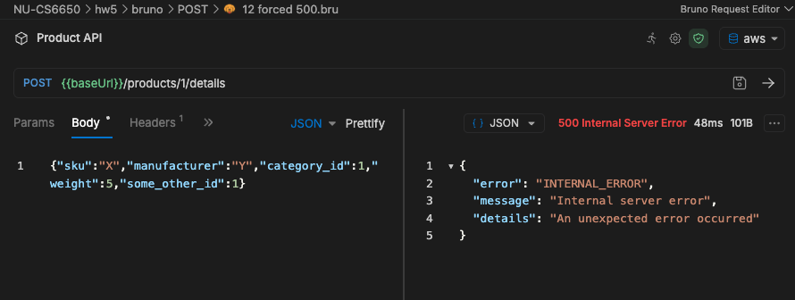 |

## Changing the code and redeploying

**The image is built for `linux/amd64`.** The Dockerfile compiles the Go binary with `GOOS=linux GOARCH=amd64` and uses an `amd64` Alpine base image. ECS Fargate runs `x86_64` by default, so this makes the deployment work from any machine. Building without it on an Apple Silicon Mac produces an `arm64` image, and the task crashes at startup with `exec format error` (shown by ECS as `Exit code: 255`).

**Terraform does not notice changes to files in `src/`.** After editing the code or the Dockerfile, `terraform plan` reports no changes. Force a rebuild and push, then tell ECS to start a new deployment so it pulls the new image:

```bash
cd terraform
terraform apply -auto-approve \
  -replace=docker_image.app -replace=docker_registry_image.app

aws ecs update-service \
  --cluster $(terraform output -raw ecs_cluster_name) \
  --service $(terraform output -raw ecs_service_name) \
  --force-new-deployment --region us-east-1
```

Run both steps, in that order. Replacing the registry image removes the old image from ECR, and a deployment that is still using it fails with `CannotPullContainerError ... not found` until a new deployment resolves `:latest` again. After a redeployment the task has a new public IP, so look it up again.

## Troubleshooting

| Symptom | Cause and fix |
|--|--|
| Task stops with `Exit code: 255`, or `exec format error` in the logs | The image architecture does not match the task (`arm64` image on `x86_64`). Keep the `amd64` settings in `src/Dockerfile` and redeploy as described above. |
| `CannotPullContainerError ... not found` | ECS is asking for an image digest that was deleted from ECR. Run `aws ecs update-services --cluster<cluster_name> --services <service_name>  --force-new-deployment --region <region name>`. |

To read the container logs:

```bash
aws logs tail /ecs/CS6650L2 --since 10m --region us-east-1
```

## Clean up

Remove everything when you are finished, so that no resources keep running:

```bash
cd terraform
terraform destroy -auto-approve
```
