# Product API on AWS ECS with Terraform

A small Product service written in Go with the [Gin](https://github.com/gin-gonic/gin) web framework.

Terraform builds the Docker image, pushes it to Amazon ECR, and runs it on Amazon ECS (Fargate), so the whole system is created and destroyed from the command line. The deployment is based on the course starter repository, adapted to run the Product API instead of the albums server.

The homework report (API specification, local and Docker test results, and deployment notes with screenshots) is in the course repository: [NU-CS6650/hw5/report.md](https://github.com/kulkarni-sharvari/NU-CS6650/blob/main/hw5/report.md).

Homework 6 adds a **product search endpoint** (`GET /products/search?q=...`), a `sync.Map` store with 100,000 generated products, and a load-test analysis on a single Fargate task. See [HW6: Product search](#hw6-product-search-and-scaling) below and the report: [NU-CS6650/hw6/report.md](https://github.com/kulkarni-sharvari/NU-CS6650/blob/main/hw6/report.md).

## Repository layout

| Path | What it contains |
|--|--|
| `src/product-service.go` | The server code: in-memory `sync.Map` store, GET, POST and search handlers, input validation, error responses |
| `src/seed.go` | Generates the 100,000 products at startup (HW6) |
| `src/observability.go` | Prometheus metrics and structured request logs (HW5 Part V) |
| `src/Dockerfile` | Multi-stage build of the server image (built for `linux/amd64`) |
| `src/go.mod`, `src/go.sum` | Go module and dependencies |
| `terraform/` | The infrastructure as code (provider, variables, outputs, and the modules below) |
| `terraform/modules/network` | Default VPC subnets and a security group that opens the container port |
| `terraform/modules/ecr` | The ECR repository that stores the image |
| `terraform/modules/logging` | The CloudWatch log group (`/ecs/CS6650L2`) |
| `terraform/modules/ecs` | The ECS cluster, Fargate task definition and service |
| `images/` | Screenshots of the deployed API (referenced below) |

## Prerequisites

* AWS CLI v2
* Terraform
* Docker, **running** during `terraform apply`, because Terraform builds the image and pushes it to ECR
* Git

Go is not required because the server is compiled inside Docker. The default region is `us-east-1`.

## Deploy

### 1. Get the code

```bash
git clone https://github.com/kulkarni-sharvari/CS6650_hw5_demo.git
cd CS6650_hw5_demo
```

### 2. Prepare credentials

Retrieve your temporary credentials from the Learner Lab, then enter the access key and secret key when prompted (use the region `us-east-1`):

```bash
aws configure
```

Then set the session token:

```bash
aws configure set aws_session_token <YOUR-TEMP-SESSION-TOKEN>
```

The access key, secret key and session token all change every time the lab restarts, so update all three.

### 3. Apply the infrastructure

```bash
cd terraform
terraform init
terraform apply -auto-approve
```

The first apply takes a few minutes, because it builds the Docker image and pushes it to ECR before ECS starts the task.

## Find the public IP address

Run this from the `terraform` folder:

```bash
IP=$(aws ec2 describe-network-interfaces \
--network-interface-ids $(
    aws ecs describe-tasks \
    --cluster $(terraform output -raw ecs_cluster_name) \
    --tasks $(
        aws ecs list-tasks \
        --cluster $(terraform output -raw ecs_cluster_name) \
        --service-name $(terraform output -raw ecs_service_name) \
        --query 'taskArns[0]' --output text
    ) \
    --query "tasks[0].attachments[0].details[?name=='networkInterfaceId'].value" \
    --output text
) \
--query 'NetworkInterfaces[0].Association.PublicIp' \
--output text)

echo $IP
```

> **Timing:** the command prints nothing, or `None`, until the task is running. This is normal and usually lasts **1 to 2 minutes after `terraform apply` finishes**. It does not mean the deployment failed. Wait a minute and run it again. You can follow the task in the ECS console (Clusters, then `CS6650L2-cluster`, then the service, then Tasks) until its status is `RUNNING`.

## Send requests

The server listens on port `8080`. The service starts with three products (IDs `1` to `3`). The commands below use the `$IP` variable from the previous step.

| # | Endpoint | Case | Command | Status |
|--|--|--|--|--|
| 1 | GET | Product found | `curl -i http://$IP:8080/products/1` | `200` |
| 2 | GET | Product not found | `curl -i http://$IP:8080/products/999` | `404` |
| 3 | GET | Malformed ID (the spec has no `400` for GET) | `curl -i http://$IP:8080/products/abc` | `404` |
| 4 | GET | Forced server error | `curl -i -H "X-Force-Error: true" http://$IP:8080/products/1` | `500` |
| 5 | POST | Valid update | see below | `204` |
| 6 | POST | Product not found | see below | `404` |
| 7 | POST | Malformed ID | see below | `400` |
| 8 | POST | Invalid input (bad JSON, wrong type, missing or out-of-range fields) | see below | `400` |
| 9 | POST | Forced server error | see below | `500` |

`POST` replaces the details of an **existing** product. It never creates a product, so a missing ID returns `404`.

```bash
# 5. 204 - valid update (empty response body)
curl -i -X POST http://$IP:8080/products/1/details \
  -d '{"sku":"NEW-SKU-1","manufacturer":"Acme","category_id":2,"weight":750,"some_other_id":55}'

# 6. 404 - product does not exist
curl -i -X POST http://$IP:8080/products/999/details \
  -d '{"sku":"X","manufacturer":"Y","category_id":1,"weight":5,"some_other_id":1}'

# 7. 400 - malformed product ID
curl -i -X POST http://$IP:8080/products/abc/details \
  -d '{"sku":"X","manufacturer":"Y","category_id":1,"weight":5,"some_other_id":1}'

# 8. 400 - invalid input (examples)
curl -i -X POST http://$IP:8080/products/1/details -d 'not json'
curl -i -X POST http://$IP:8080/products/1/details -d '{}'
curl -i -X POST http://$IP:8080/products/1/details \
  -d '{"sku":"X","manufacturer":"Y","category_id":0,"weight":5,"some_other_id":1}'
curl -i -X POST http://$IP:8080/products/1/details \
  -d '{"sku":"X","manufacturer":"Y","category_id":1,"weight":-1,"some_other_id":1}'

# 9. 500 - forced server error
curl -i -X POST -H "X-Force-Error: true" http://$IP:8080/products/1/details \
  -d '{"sku":"X","manufacturer":"Y","category_id":1,"weight":5,"some_other_id":1}'
```

**Validation rules for the request body (all fields are required):** 
* sku: non empty and not more than 100 characters long
* manufacturer: non empty and not more than 200 characters long
* category_id: minimum 1
* weight: minimum 0
* some_other_id: minimum 1
* request body: must be well-formed JSON and each field must have the correct type (for example, "category_id": "abc" is rejected). The response uses the message Invalid request body with the details Bad request.

**About the `500` response:** the in-memory store cannot fail on its own, so a recovery middleware turns any panic into a `500` response. Sending the header `X-Force-Error: true` triggers one on purpose so that the response can be demonstrated. This header is a test-only hook.

**Schema**

**Product schema**

| Field | Type | Description |
|--|--|--|
| `product_id` | integer (`int64`) | Unique identifier of the product |
| `sku` | string (1 to 100 characters) | Stock Keeping Unit, a unique product code |
| `manufacturer` | string (1 to 200 characters) | Name of the manufacturer |
| `category_id` | integer (`int32`) | Identifier of the product category |
| `weight` | integer (`int32`) | Product weight in grams |
| `some_other_id` | integer (`int32`) | Additional product identifier |

**Error schema**

| Field | Type | Description |
|--|--|--|
| `error` | string | Machine-readable error code (for example, `NOT_FOUND`) |
| `message` | string | Human-readable error message |
| `details` | string | Additional context about the error |

### Screenshots from the deployed service

These requests were sent to the service running on ECS (using a Bruno collection, plus one `curl`).

| Case | Screenshot |
|--|--|
| GET `200` |  |
| GET `404`, product not found |  |
| GET `404`, malformed ID |  |
| GET `404`, ID `0` |  |
| GET `500` |  |
| POST `204` |  |
| GET after the update |  |
| POST `404` |  |
| POST `400`, malformed ID |  |
| POST `400`, invalid JSON |  |
| POST `400`, wrong field type |  |
| POST `400`, empty object |  |
| POST `400`, empty `sku` |  |
| POST `400`, `sku` over 100 characters |  |
| POST `400`, negative `weight` |  |
| POST `400`, `category_id` of 0 |  |
| POST `500` |  |

## Changing the code and redeploying

**The image is built for `linux/amd64`.** The Dockerfile compiles the Go binary with `GOOS=linux GOARCH=amd64` and uses an `amd64` Alpine base image. ECS Fargate runs `x86_64` by default, so this makes the deployment work from any machine. Building without it on an Apple Silicon Mac produces an `arm64` image, and the task crashes at startup with `exec format error` (shown by ECS as `Exit code: 255`).

**Terraform does not notice changes to files in `src/`.** After editing the code or the Dockerfile, `terraform plan` reports no changes. Force a rebuild and push, then tell ECS to start a new deployment so it pulls the new image:

```bash
cd terraform
terraform apply -auto-approve \
  -replace=docker_image.app -replace=docker_registry_image.app

aws ecs update-service \
  --cluster $(terraform output -raw ecs_cluster_name) \
  --service $(terraform output -raw ecs_service_name) \
  --force-new-deployment --region us-east-1
```

Run both steps, in that order. Replacing the registry image removes the old image from ECR, and a deployment that is still using it fails with `CannotPullContainerError ... not found` until a new deployment resolves `:latest` again. After a redeployment the task has a new public IP, so look it up again.

## Troubleshooting

| Symptom | Cause and fix |
|--|--|
| Task stops with `Exit code: 255`, or `exec format error` in the logs | The image architecture does not match the task (`arm64` image on `x86_64`). Keep the `amd64` settings in `src/Dockerfile` and redeploy as described above. |
| `CannotPullContainerError ... not found` | ECS is asking for an image digest that was deleted from ECR. Run `aws ecs update-service --cluster <cluster_name> --service <service_name>  --force-new-deployment --region <region name>`. |

To read the container logs:

```bash
aws logs tail /ecs/CS6650L2 --since 10m --region us-east-1
```

## Load testing with Locust

The load tests are in `test/`. They run against the deployed service, so deploy it first and look up the public IP (see above). The full analysis is in the [report](https://github.com/kulkarni-sharvari/NU-CS6650/blob/main/hw5/report.md#part-iv-testing).

### Setup

```bash
python3 -m venv .venv
source .venv/bin/activate
pip install -r test/requirements.txt
```

### Files

| File | Contents |
|--|--|
| `test/locustfile.py` | The shared tasks (9 `GET` to 1 `POST`, product IDs 1 to 3) and the user classes `ProductHttpUser`, `ProductFastHttpUser` and `ProductStressUser` |
| `test/shape_step.py` | The step load shape for the stress test (10, 25, 50, 100, 200 and 400 users, 90 s each) |
| `test/shape_spike.py` | A spike load shape |

### Running the tests

Replace `<IP>` with the task's public IP and run each command from the repository root. Open `http://localhost:8089` and press **Start**.

```bash
# Test 1: baseline, 1 user (HttpUser, with a wait of 0.1 to 0.5 s between requests)
# Tests 2 and 3: 50 users, spawn rate 10, with the same wait, using ProductHttpUser and ProductFastHttpUser
locust -f test/locustfile.py --host http://<IP>:8080 ProductHttpUser

# Tests 4 and 5: 200 users, spawn rate 20, no wait
locust -f test/locustfile.py --host http://<IP>:8080 ProductHttpUser
locust -f test/locustfile.py --host http://<IP>:8080 ProductFastHttpUser

# Test 6: stress test, step load with 4 worker processes (the user count comes from the shape)
locust -f test/locustfile.py,test/shape_step.py --host http://<IP>:8080 --processes 4 ProductStressUser
```

Tests 1 to 3 used a wait of 0.1 to 0.5 s between requests, and tests 4 to 6 used none. The user classes in `test/locustfile.py` have no wait time. To reproduce tests 1 to 3, add `wait_time = between(0.1, 0.5)` to the class (and `between` to the `locust` import). 

### Results

All tests finished with 0 failures.

| Test | Setup | RPS | Median / 95th / 99th (ms) |
|--|--|--|--|
| 1 | `HttpUser`, 1 user | 3.2 | 22 / 27 / 73 |
| 2 | `HttpUser`, 50 users | 154.2 | 23 / 73 / 150 |
| 3 | `FastHttpUser`, 50 users | 154.3 | 21 / 26 / 28 |
| 4 | `HttpUser`, 200 users, no wait | 3,757 | 37 / 80 / 93 |
| 5 | `FastHttpUser`, 200 users, no wait | 3,963 | 38 / 91 / 120 |
| 6 | Step load, 10 to 400 users | 4,457 overall (ceiling about 4,400) | 29 / 110 / 170 |

**Findings.** The server handles about 3,400 requests per second comfortably (up to about 100 users) and levels off at about 4,400 requests per second. Beyond 100 users, extra users only increase latency (the median rises from 24 ms to 93 ms at 400 users) and do not add throughput. There were no errors. The task has 0.25 vCPU, and CloudWatch shows its CPU at about 90 % at the plateau, so the limit is CPU. See the [report](https://github.com/kulkarni-sharvari/NU-CS6650/blob/main/hw5/report.md#part-iv-testing) for the analysis, the `HttpUser` and `FastHttpUser` comparison, and the limitations.

### Screenshots

**Test 1: `HttpUser`, 1 user**

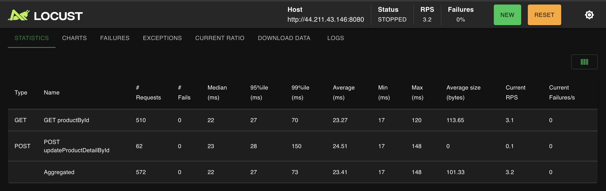
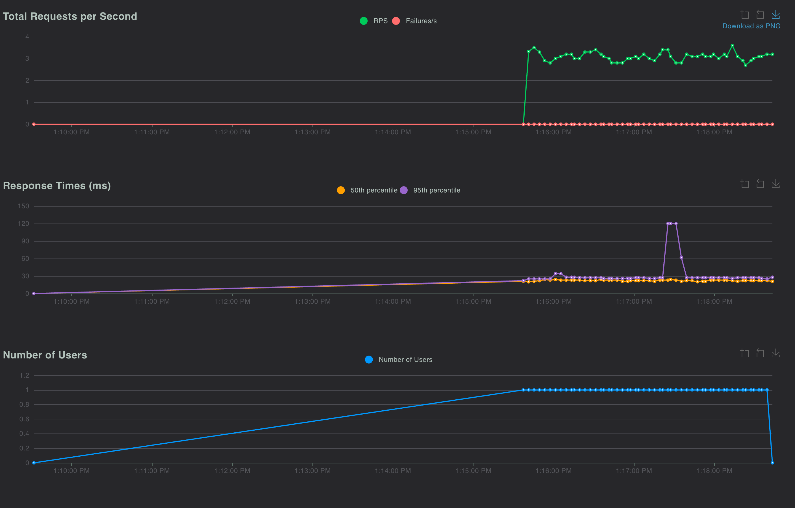

**Test 2: `HttpUser`, 50 users**

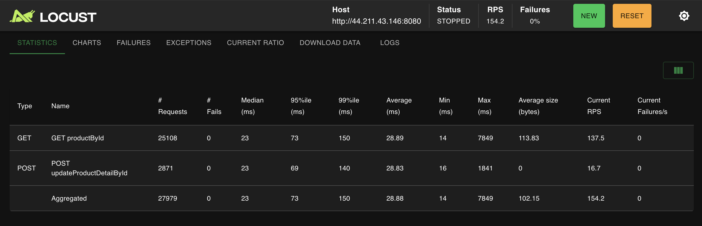
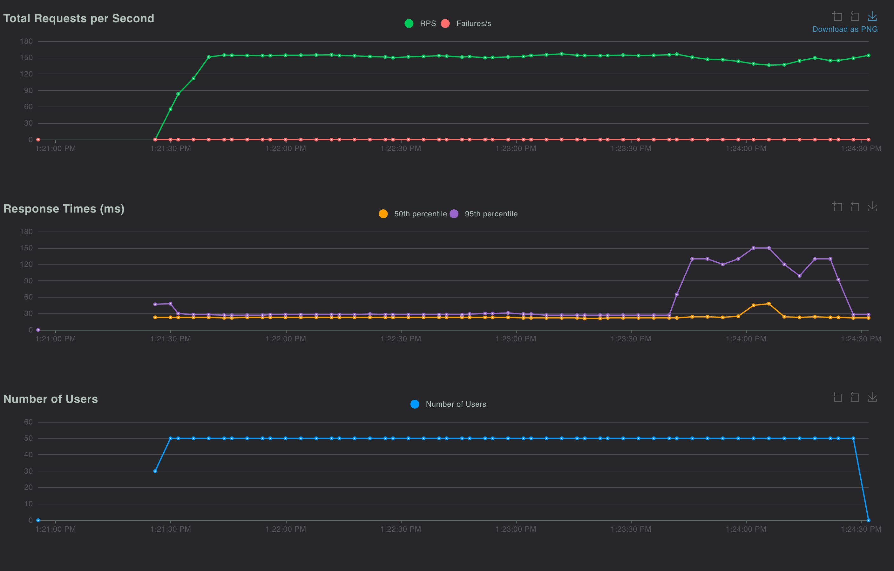

**Test 3: `FastHttpUser`, 50 users**

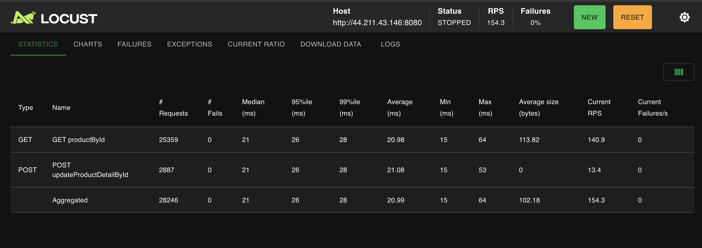
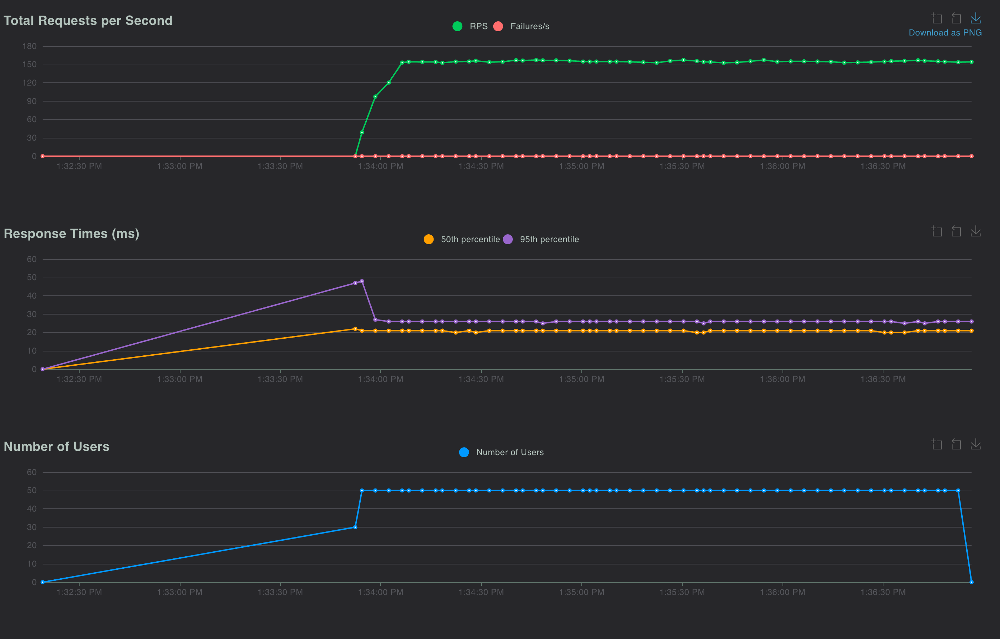

**Test 4: `HttpUser`, 200 users, no wait**

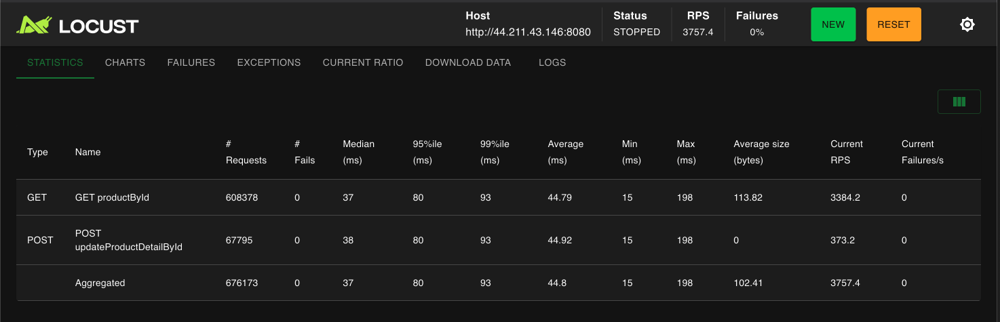
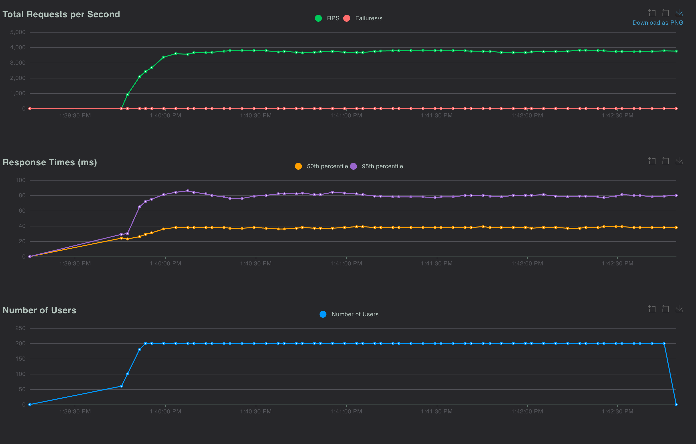

**Test 5: `FastHttpUser`, 200 users, no wait**

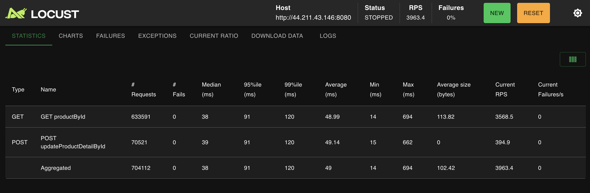
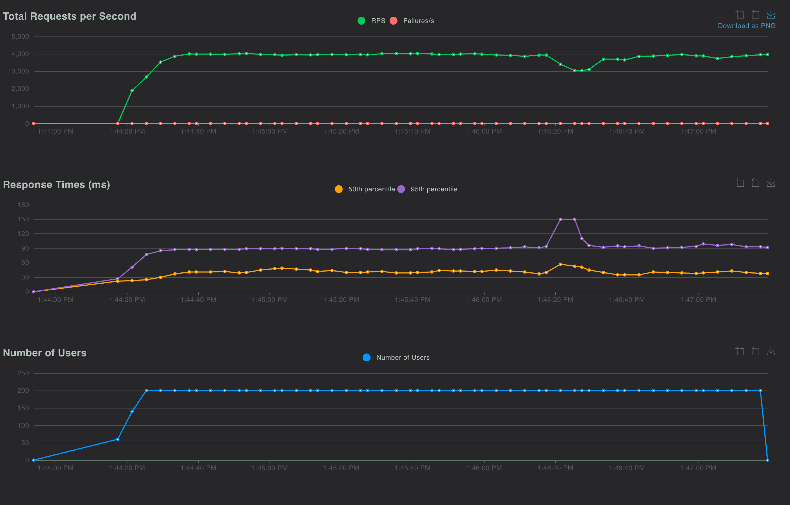

**CloudWatch CPU, tests 1 to 5**

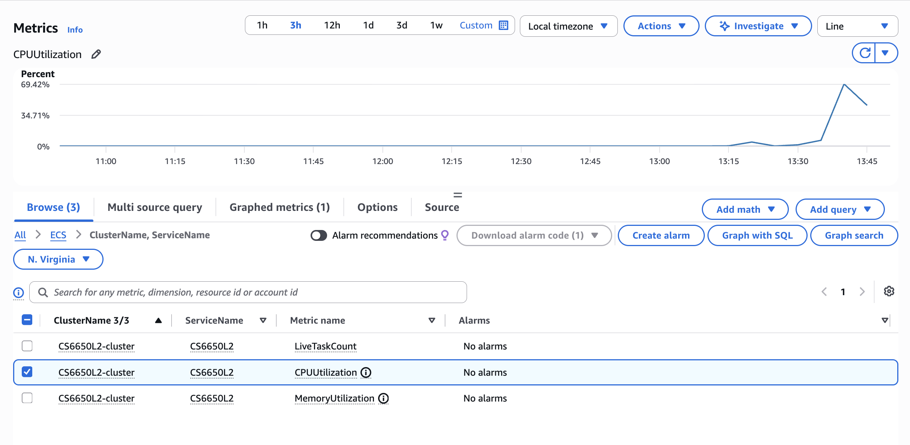

**Test 6: stress test (step load)**

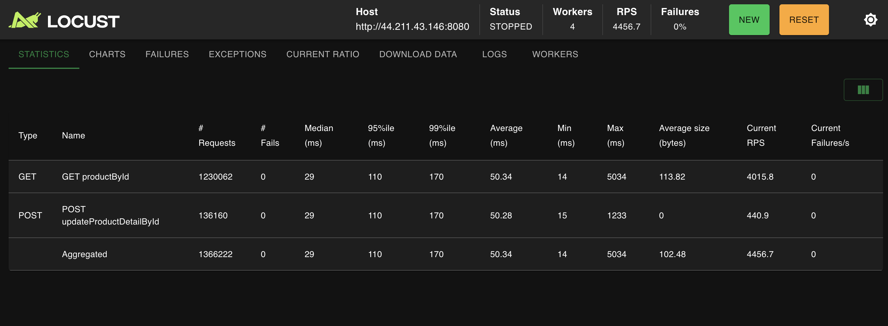
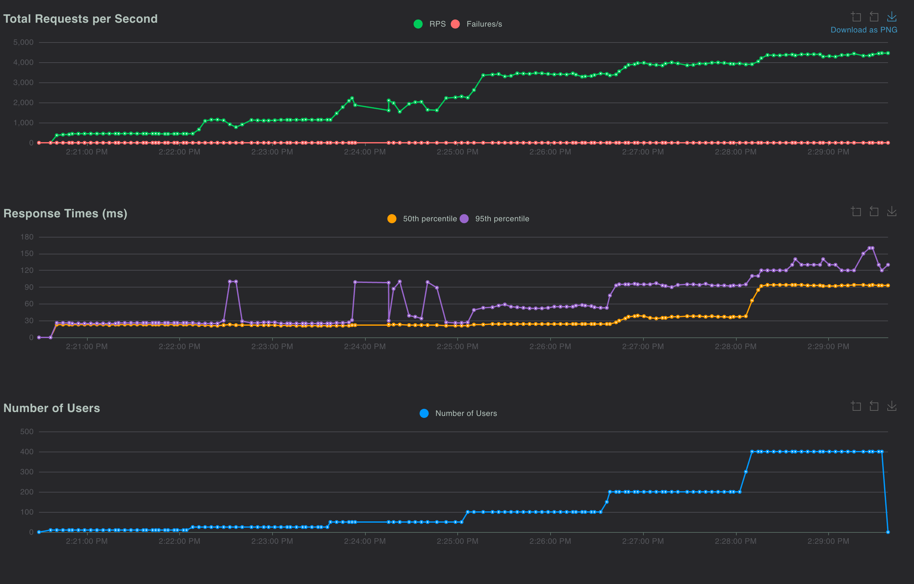
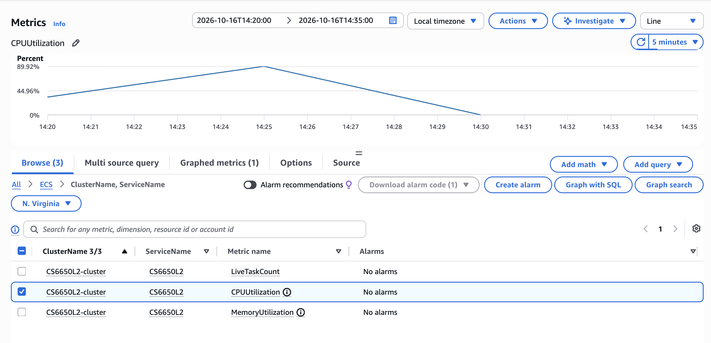

## Part V: Observability — Know Your Vitals

The server records the three RED signals for every endpoint, in two ways:

* **Rate** (requests per second), **Errors** (the share of non-2xx responses) and **Duration** (latency, as p50 and p95) as **Prometheus metrics**, shown on a Grafana dashboard.
* The same data as **one JSON log line per request** (endpoint, status code and duration), for debugging after the fact.

The monitoring stack runs **locally** with Docker Compose, next to a local copy of the app. The code is in `src/observability.go`, and the full write-up is in the [report](https://github.com/kulkarni-sharvari/NU-CS6650/blob/main/hw5/report.md#part-v-observability-know-your-vitals).

### The metrics

| Metric | Type | Labels | Meaning |
|--|--|--|--|
| `http_requests_total` | counter | `method`, `route`, `code` | Every request handled (the rate) |
| `http_request_errors_total` | counter | `method`, `route`, `code` | Requests that returned a non-2xx status |
| `http_request_duration_seconds` | histogram | `method`, `route` | Time spent handling a request, in 20 buckets from 1 microsecond to 2.5 seconds |

The `route` label is the route pattern (`/products/:productId`), not the real path, so there is one time series per endpoint and not one per product ID. A middleware (`observabilityMiddleware`) records all three metrics and writes the log line, so no handler has to. The metrics are served at `GET /metrics`, in Prometheus text format.

### Run the stack

```bash
cd src
docker compose up -d --build
```

| Service | URL | Notes |
|--|--|--|
| App | http://localhost:8080 | The Product API, with `/metrics` |
| Prometheus | http://localhost:9090 | Scrapes `app:8080/metrics` every 5 seconds (`src/prometheus.yaml`). **Status, then Targets** should show the app as UP. |
| Grafana | http://localhost:3000 | The Prometheus data source is provisioned from `src/grafana.yml`. |

Stop it with `docker compose stop`.

### The dashboard

The data source is provisioned automatically, but the dashboard was created in the Grafana interface. The three panels with queries:

| Panel | Query | Legend | Unit |
|--|--|--|--|
| Request rate | `sum by (route) (rate(http_requests_total[30s]))` | `{{route}}` | requests/sec |
| Error rate | `100 * sum by (route) (rate(http_request_errors_total[30s])) / sum by (route) (rate(http_requests_total[30s]))` | `{{route}}` | percent (0-100) |
| Latency | A: `histogram_quantile(0.50, sum by (le, route) (rate(http_request_duration_seconds_bucket[30s])))`<br>B: `histogram_quantile(0.95, sum by (le, route) (rate(http_request_duration_seconds_bucket[30s])))` | `p50 {{route}}`, `p95 {{route}}` | seconds |

Counters only ever increase, so the panels use `rate()` to turn them into per-second values, and `histogram_quantile()` to turn the histogram buckets into percentiles.

### Generate load

The user class `ProductObservabilityUser` in `test/locustfile.py` sends 80 % `GET` of an existing product, 10 % valid `POST`, 8 % `GET` of a missing product (`404`) and 2 % `GET` with the test header `X-Force-Error: true` (`500`). The deliberate errors give the error panel and the logs something to show.

```bash
locust -f test/locustfile.py --host http://localhost:8080 \
  --processes 2 -u 200 -r 20 -t 5m --autostart --autoquit 10 \
  ProductObservabilityUser
```

The run shown below had about 5 minutes of idle time first, then 5 minutes of load, then idle again.

### Dashboard during the run

Idle, then about 1,430 requests per second on `/products/:productId` and 160 on `/details`, then idle again. Latency exists only while there is traffic: `GET` p50 is about 11 microseconds and `POST` about 42. The error rate is about 11 % on the `GET` route, which matches the 404 and 500 requests that were injected.

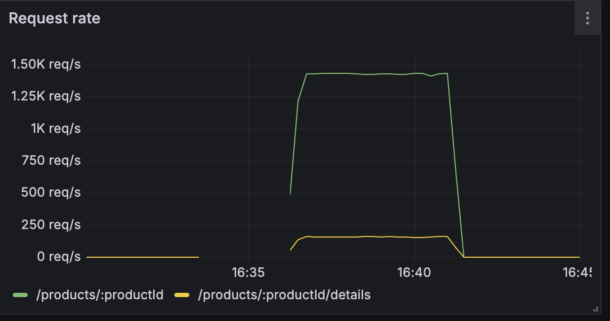
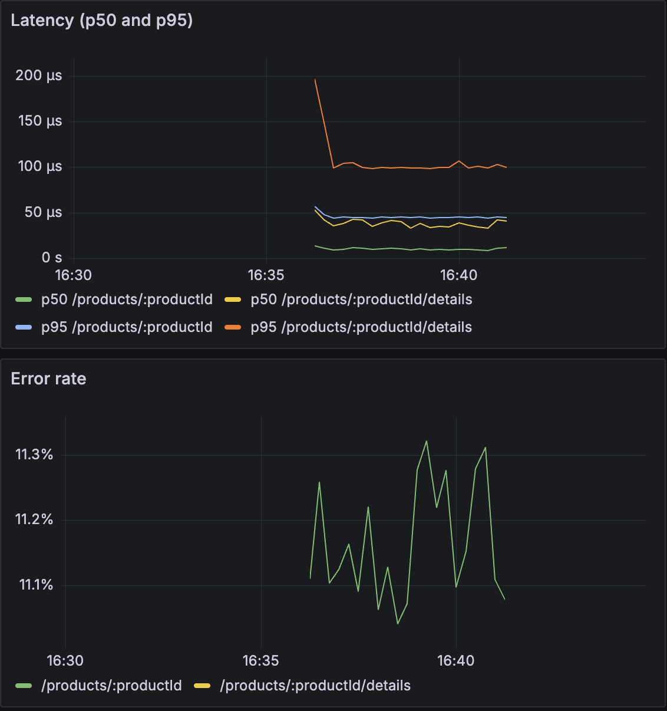

### Structured logs

Every request writes one JSON object to stdout. Read them with:

```bash
cd src
docker compose logs app --no-log-prefix --since 15m | grep -m3 '"status":200'
docker compose logs app --no-log-prefix --since 15m | grep -m3 '"level":"WARN"'
docker compose logs app --no-log-prefix --since 15m | grep -m2 '"level":"ERROR"'
```

The level follows the status: `INFO` for 2xx, `WARN` for 4xx and `ERROR` for 5xx. An excerpt from the middle of the load run (also saved in [`logs/request-log-excerpt.jsonl`](./logs/request-log-excerpt.jsonl)):

```json
{"time":"2026-10-17T20:38:00.000495002Z","level":"INFO","msg":"request","method":"GET","endpoint":"/products/:productId","path":"/products/2","status":200,"duration_ms":0.014}
{"time":"2026-10-17T20:38:00.002219627Z","level":"INFO","msg":"request","method":"POST","endpoint":"/products/:productId/details","path":"/products/1/details","status":204,"duration_ms":0.062}
{"time":"2026-10-17T20:38:00.01321821Z","level":"WARN","msg":"request","method":"GET","endpoint":"/products/:productId","path":"/products/999","status":404,"duration_ms":0.051}
{"time":"2026-10-17T20:38:00.007626585Z","level":"ERROR","msg":"panic","error":"forced error for testing"}
{"time":"2026-10-17T20:38:00.007693044Z","level":"ERROR","msg":"request","method":"GET","endpoint":"/products/:productId","path":"/products/1","status":500,"duration_ms":0.075}
```

Counting the log lines of the same 5-minute run gives the same picture as the dashboard: 469,182 requests (about 1,590 per second), 79.9 % `200`, 10.0 % `204`, 8.0 % `404` and 2.0 % `500`, so 10.1 % errors overall.

## HW6: Product search and scaling

Homework 6 keeps the Homework 5 service (the HW5 code is at the git tag `hw5-final`; the HW6 work is on the branch `hw6-syncmap`) and adds a search that does a **fixed amount of work per request**, so that the effect of adding compute can be measured.

### What changed

| | Homework 5 | Homework 6 |
|--|--|--|
| Product store | `map[int64]Product` + `sync.RWMutex` | `sync.Map` |
| ID counter | `int64` guarded by the mutex | `atomic.Int64` |
| Products at startup | 3 | **100,000** (generated by `src/seed.go`) |
| Endpoints | `GET /products/{id}`, `POST /products/{id}/details` | the same, plus **`GET /products/search?q=`** |

* **Generated data.** Each product is named `Product [Brand] [ID]` (for example `Product Alpha 1`) and the name is stored in the `sku` field. The brand is the `manufacturer`, and the category rotates through five categories (`electronics`, `clothing`, `books`, `home`, `toys`) with a modulo of the ID. There is no randomness, so every start produces the same data. The `Product` schema is unchanged.
* **Category names.** Products carry only a `category_id`. The names live in a read-only map (`categoryNamesMap`) that is never written after startup, so concurrent reads need no lock.

### The search endpoint

```bash
curl "http://localhost:8080/products/search?q=alpha"
```

```json
{"products":[{"product_id":8,"sku":"Product Alpha 8","manufacturer":"Alpha","category_id":4,"weight":108,"some_other_id":9}],"total_count":12,"search_time":0.116604}
```

| Rule | Behavior |
|--|--|
| Products checked | Exactly **100**: the IDs `offset+1` to `offset+100` (IDs 1 to 100 by default). The scan never stops early, even after 20 matches, so every request costs the same |
| Match | Case-insensitive "contains" of `q` in the product name (`sku`) **or** in the category name derived from `category_id` |
| Result size | At most **20 products**. `total_count` counts all matches among the 100 checked |
| No match | `200` with `"products": []` and `"total_count": 0` |
| Invalid `q` | `400` in the `Error` format if `q` is missing, empty (after trimming) or longer than 100 characters |
| `search_time` | Milliseconds spent in the scan loop only, as a float |
| `offset` (optional) | Moves the 100-product window. **Not in the yaml.** Lenient: a missing, unparsable or negative value is `0`, and a value above `99900` is `99900` |

The scan uses `sync.Map.Load` on consecutive IDs and not `Range`, so the set of 100 products is known and the work per request is constant:

```go
for count := int64(1); count <= 100; count++ {
    v, ok := s.products.Load(offset + count)
    if ok {
        prod := v.(Product)
        if strings.Contains(strings.ToLower(prod.SKU), query) ||
            strings.Contains(categoryNamesMap[prod.CategoryID], query) {
            if matches < 20 {
                products = append(products, prod)
            }
            matches++
        }
    }
}
```

Broad Query: search term = "product"
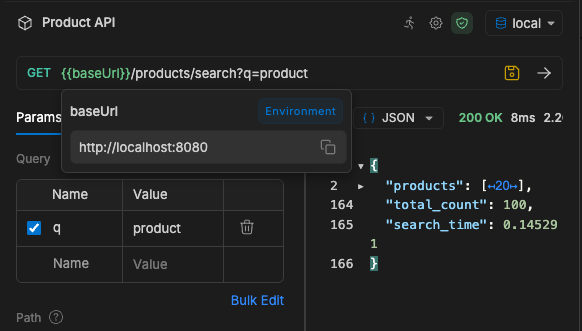

Case Insensitive search
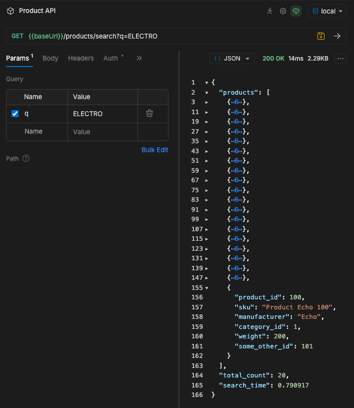

The metrics and logs from Part V report the new route as its own series (`route="/products/search"`), because the middleware labels requests with `c.FullPath()`.

### Run it

Locally with the monitoring stack (the search route appears in Prometheus and Grafana as soon as it is called):

```bash
cd src
docker compose up -d --build
curl "http://localhost:8080/products/search?q=electro"
```

On AWS, deploy with `terraform apply` as above. The task is 256 CPU units, 512 MB and 1 instance (the defaults in `terraform/modules/ecs/variables.tf`).

### Load tests

The search tests use the class `ProductSearchUser` in `test/locustfile.py`: a `FastHttpUser` with no wait time that picks one of six common terms at random (`electro`, `books`, `toys`, `alpha`, `delta`, `product`).

```bash
# Test 1: 5 users, 2 minutes      Test 2: 20 users, 3 minutes      Extra: 60 users, 3 minutes
locust -f test/locustfile.py --host http://<IP>:8080 -u 5 -r 5 -t 2m \
  --autostart --autoquit 180 --csv results/test1 --html results/test1.html ProductSearchUser
```

Change `-u`, `-r` and `-t` for the other runs. Quote URLs that contain `?` in zsh, for example `"http://<IP>:8080/products/search?q=alpha"`.

### Results

All runs used one Fargate task (0.25 vCPU, 512 MB) and a laptop as the load generator (about 23 ms round trip to the task).

| | Test 1 | Test 2 | Extra run |
|--|--|--|--|
| Users | 5 | 20 | 60 |
| Requests/s | 212 | 729 | about 1,500 |
| Median | 24 ms | 23 ms | 27 ms |
| 95th / 99th percentile | 27 / 41 ms | 48 / 100 ms | **96 / 180 ms** |
| Failures | 0 | 0 | 0 |
| CPU, busiest minute | 16.3 % | 53.2 % | **97.7 %** |
| Memory, maximum (of 512 MiB) | 9.4 % | 9.8 % | 10.6 % |
| CPU cost per request | about 0.19 ms | about 0.18 ms | about 0.16 ms |

* The cost of a search is nearly constant, so **CPU grows in proportion to the request rate**, and a single 0.25 vCPU task saturates at about **1,500 requests per second**. At saturation (60 users) the throughput stops growing and the 95th and 99th percentiles rise, while the median hardly moves and there are no errors.
* The in-service `search_time` stayed at about 0.04 ms while the client saw about 49 ms per request on a new connection: the response time is dominated by the network and by queueing, not by the scan.
* The CPU in Tests 1 and 2 is lower than the assignment's example because the laptop's network round trip limits how many requests 5 or 20 users can send. The extra 60-user run reaches the saturation point.
* **Conclusion:** the work per request is already bounded and the scan is only a small part of the cost, so the remedy for saturation is **more tasks (scale out)**, not a faster scan.

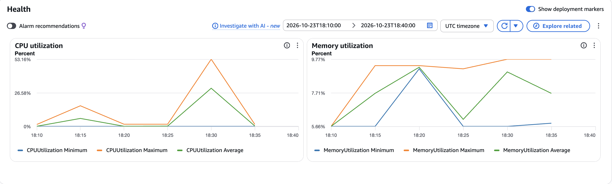

The full analysis, with all screenshots, is in the report: [NU-CS6650/hw6/report.md](https://github.com/kulkarni-sharvari/NU-CS6650/blob/main/hw6/report.md).

## Clean up

Remove everything when you are finished, so that no resources keep running:

```bash
cd terraform
terraform destroy -auto-approve
```
